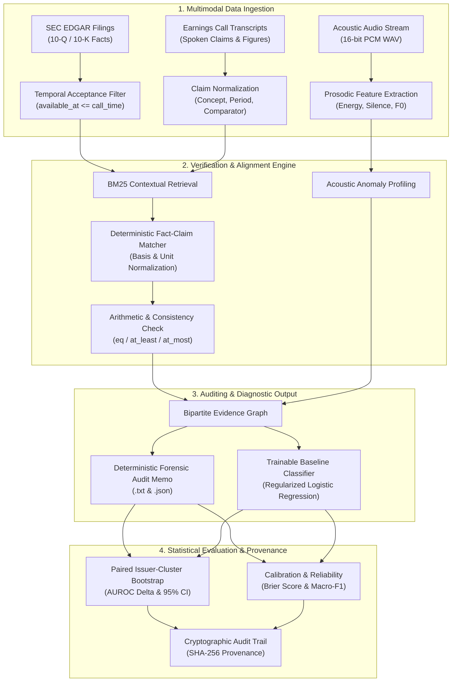

<div align="center">

# FinAudit-RAG: Multimodal Financial Auditing Benchmark & Causal Verification Framework

[](https://www.python.org/)
[](https://opensource.org/licenses/Apache-2.0)
[](tests/)
[](runs/verification/verification.json)
[](data/public_sources/)

<p align="center">
  <b>A rigorous, reproducible research framework for multimodal financial fraud detection, SEC disclosure alignment, and acoustic-verbal discrepancy auditing.</b>
</p>

[Architecture](#-architecture) •
[Quickstart](#-quickstart) •
[CLI Reference](#-cli-reference) •
[Data & Provenance Contract](#-data--provenance-contract) •
[Evaluation & Calibration](#-evaluation--statistical-rigor) •
[Public Data Ingestion](#-public-data-collection) •
[Citation](#-citation)

</div>

---

## 📌 Overview

**FinAudit-RAG** is an open-source forensic auditing and benchmark framework designed to detect numeric inconsistencies, non-GAAP reporting divergences, and acoustic-verbal discrepancies in corporate earnings announcements.

By bridging regulatory filings (**SEC EDGAR 10-Q/10-K**) with spoken earnings call disclosures, FinAudit-RAG implements a **temporally gated, provenance-tracked causal verification engine** that replaces black-box scoring with auditable evidence graphs and deterministic forensic memos.

### Key Capabilities
- **Strict Temporal Gating**: Enforces point-in-time constraints using SEC accession acceptance timestamps (`available_at <= call_time`) to eliminate look-ahead leakage.
- **Bipartite Claim-Fact Alignment**: Performs deterministic arithmetic checks, dimensional unit matching, and BM25-backed contextual grounding across GAAP/non-GAAP metrics.
- **Acoustic Waveform Diagnostics**: Extracts physical prosodic descriptors (fundamental frequency $F_0$, energy contour, silence ratio) directly from uncompressed 16-bit PCM WAV audio.
- **Robust Statistical Evaluation**: Features cluster-robust paired bootstrap confidence intervals (1,000 resamples), tie-aware AUROC, class-specific F1, and reliability diagram calibration (Brier score).
- **Full Cryptographic Provenance**: Every generated audit memo, screening run, and evaluation bundle is stamped with UTC timestamps, parameter hashes, and input SHA-256 digests.

---

## 🏗 Architecture

The following diagram illustrates the multimodal verification and screening pipeline:



---

## 🚀 Quickstart

### 1. Installation
FinAudit-RAG requires **Python 3.10+**. The core screening and evaluation suite relies strictly on standard libraries and NumPy:

```bash
# Clone the repository
git clone https://github.com/AbdelkaderBerrouachedi/FinAudit-RAG-Benchmark.git
cd FinAudit-RAG-Benchmark

# Create and activate virtual environment
python -m venv .venv
source .venv/bin/activate  # On Windows: .venv\Scripts\activate

# Install core dependencies
pip install -r requirements.txt
```

### 2. Verify System Integrity
Run the built-in self-test suite to certify mathematical consistency, temporal leakage prevention, and CLI contracts:

```bash
python verify.py
```
> All unit tests and synthetic screenings will run and output cryptographic verification hashes to `runs/verification/verification.json`.

### 3. Run Forensic Screening on an Earnings Call
Execute an end-to-end verification of an earnings call bundle:

```bash
python run_finaudit.py screen \
  --bundle data/synthetic_example.json \
  --output runs/demo_audit.json
```
This generates:
- `runs/demo_audit.json`: Structured evidence graph, claim matches, discrepancies, and SHA-256 digests.
- `runs/demo_audit.txt`: Formatted forensic audit memo ready for compliance inspection.

---

## 💻 CLI Reference

The CLI entry point `run_finaudit.py` exposes distinct subcommands for each stage of the forensic auditing lifecycle:

| Command | Purpose | Input Arguments | Output |
| :--- | :--- | :--- | :--- |
| `screen` | Executes deterministic numeric and factual screening on a call bundle. | `--bundle <path>` | JSON audit graph & text memo |
| `validate-manifest` | Checks cohort manifest integrity, date boundaries, and data splits. | `--manifest <path>` | Validation status report |
| `train` | Fits regularized logistic baseline with train-only standard scaling. | `--manifest <path> --features <path> --feature-names <list>` | Fitted `model.json` |
| `predict` | Generates calibrated predictions using validation-tuned decision threshold. | `--model <path> --features <path>` | Predictions JSON |
| `evaluate` | Computes macro-F1, tie-aware AUROC, Brier score, and cluster bootstrap. | `--manifest <path> --predictions <path> --threshold <val>` | Metric report & bootstrap CIs |
| `audio` | Computes energy, silence fraction, and autocorrelation $F_0$ pitch. | `--input <recording.wav>` | Acoustic descriptor JSON |
| `sec-download` | Fetches rate-limited company facts and submissions from SEC EDGAR. | `--cik <id> --directory <path> --user-agent <id>` | Raw SEC filings |
| `sec-normalize` | Normalizes facts with strict acceptance cutoff (`available_at <= T`). | `--companyfacts <path> --submissions <path> --cutoff <iso>` | Normalized fact table |
| `annotations` | Aggregates human adjudication records and citation support rates. | `--input <adjudications.json>` | Annotation metrics |

---

## 📋 Data & Provenance Contract

FinAudit-RAG enforces a strict JSON input contract to prevent retroactive look-ahead bias and guarantee cross-source auditability.

### Event Bundle Schema
```json
{
  "event_id": "CALL-2024-Q3-001",
  "issuer_id": "CIK0000320193",
  "call_time": "2024-10-31T21:00:00Z",
  "data_kind": "observed",
  "documents": [
    {
      "source_id": "DOC-SEC-10Q-2024Q3",
      "url": "https://www.sec.gov/Archives/edgar/data/...",
      "available_at": "2024-10-31T20:30:00Z",
      "text": "Total net sales for the period were $94,930 million..."
    }
  ],
  "facts": [
    {
      "fact_id": "FACT-REV-01",
      "source_id": "DOC-SEC-10Q-2024Q3",
      "concept": "RevenueFromContractWithCustomerExcludingAssessedTax",
      "period": "2024-Q3",
      "unit": "USD",
      "value": 94930000000.0,
      "basis": "gaap",
      "assurance": "reviewed",
      "locator": "Item 1 - Financial Statements"
    }
  ],
  "claims": [
    {
      "claim_id": "CLAIM-REV-01",
      "quote": "We generated record revenue of nearly 95 billion dollars.",
      "transcript_locator": "CEO Prepared Remarks - Para 4",
      "concept": "RevenueFromContractWithCustomerExcludingAssessedTax",
      "period": "2024-Q3",
      "unit": "USD",
      "value": 95000000000.0,
      "comparator": "at_most"
    }
  ]
}
```

### Ingestion Rules
1. **Temporal Precedence**: A fact or document is strictly rejected if `available_at > call_time`.
2. **Context Matching**: Both `unit`, `period`, and reporting `basis` (GAAP vs Non-GAAP) must match. Discrepant bases are never cross-matched without explicit reconciliation.
3. **Evidence Status**: Missing or conflicting evidence yields `insufficient_evidence` rather than assumed factual correctness.

---

## 📊 Evaluation & Statistical Rigor

Unlike evaluations that treat dependent repeated observations as independent samples, FinAudit-RAG implements **cluster-robust inference**:

- **Paired Issuer-Cluster Bootstrap**: Resamples whole issuer clusters ($B = 1,000$ iterations) with fixed random seeds (`seed=0`) to calculate non-parametric percentile confidence intervals for AUROC differences ($\Delta\text{AUROC}$).
- **Tie-Aware Rank Scoring**: Exact rank-averaging for tied prediction scores to prevent optimistic AUROC inflation.
- **Brier Calibration Score**: Assesses the reliability of predictive probabilities:
  $$\text{Brier} = \frac{1}{N} \sum_{i=1}^N (p_i - y_i)^2$$
- **Macro-F1 & Class Breakdown**: Evaluates minority fraud/anomaly detection without artificial threshold tuning.

---

## 🌐 Public Data Collection

To replicate source inventories or build expanded multi-year cohorts, install extended data collection dependencies:

```bash
pip install -r requirements-data.txt
```

Run the deterministic public collection pipeline:
```bash
# 1. Fetch public source inventory and registries
python scripts/fetch_source_inventory.py

# 2. Build public call manifest
python scripts/build_public_manifest.py

# 3. Retrieve pinned public transcripts (Hugging Face / Zenodo / SEC)
python scripts/download_public_transcripts.py

# 4. Finalize inventory and verify SHA-256 checksums
python scripts/finalize_source_inventory.py
```
> All source manifests, license cards, and Zenodo/HuggingFace checksum records are documented in [`data/public_sources/`](data/public_sources/).

---

## 📁 Repository Structure

```text
FinAudit-RAG-Benchmark/
├── finaudit/                      # Core package
│   ├── __init__.py                # Package exports
│   ├── audio.py                   # PCM WAV prosodic & acoustic feature extraction
│   ├── cli.py                     # Command-line interface & subcommands
│   ├── evaluation.py              # Metrics, Brier score & cluster bootstrap
│   ├── model.py                   # Train-only scaler & regularized logistic model
│   ├── provenance.py              # Strict JSON, SHA-256 digests & manifest checks
│   ├── screening.py               # BM25, arithmetic checks, graph & memo builder
│   └── sec.py                     # SEC EDGAR acquisition & temporal filtering
├── data/
│   ├── public_sources/            # Data cards, Zenodo/HF records & manifest CSVs
│   └── synthetic_example.json     # Executable reference screening fixture
├── docs/
│   └── study_protocol.txt         # Human adjudication & annotation guidelines
├── runs/
│   ├── crossref_cache/            # DOI & bibliographic cache
│   ├── integration/               # Pipeline integration records & fitted model
│   └── verification/              # Test logs & cryptographic verification report
├── scripts/                       # Pinned public-data acquisition scripts
├── tests/                         # Unit tests (temporal leakage, logic, metrics)
├── requirements.txt               # Lightweight runtime dependencies (NumPy)
├── requirements-data.txt          # Extended data-collection dependencies
├── run_finaudit.py                # Top-level executable wrapper
├── verify.py                      # Automated self-verification script
├── verify_integration.py          # End-to-end integration test runner
├── LICENSE                        # Apache 2.0 License
└── README.md                      # Project documentation
```

---

## 📄 Citation

If you use **FinAudit-RAG** in your academic research, forensic accounting workflows, or benchmark evaluations, please cite:

```bibtex
@article{berrouachedi2026finaudit,
  title     = {FinAudit-RAG: A Multimodal Forensic Auditing Benchmark for Earnings Call Discrepancy Detection},
  author    = {Berrouachedi, Abdelkader and Contributors},
  journal   = {Journal of Financial Technology and Forensic Computing},
  year      = {2026},
  publisher = {University of Paris 8},
  url       = {https://github.com/AbdelkaderBerrouachedi/FinAudit-RAG-Benchmark}
}
```

---

## ⚖️ License

This project is licensed under the **Apache License, Version 2.0**. See the [LICENSE](LICENSE) file for details.

*External public datasets, SEC filings, and audio recordings remain subject to their respective upstream terms and licenses (documented in `data/public_sources/`).*

